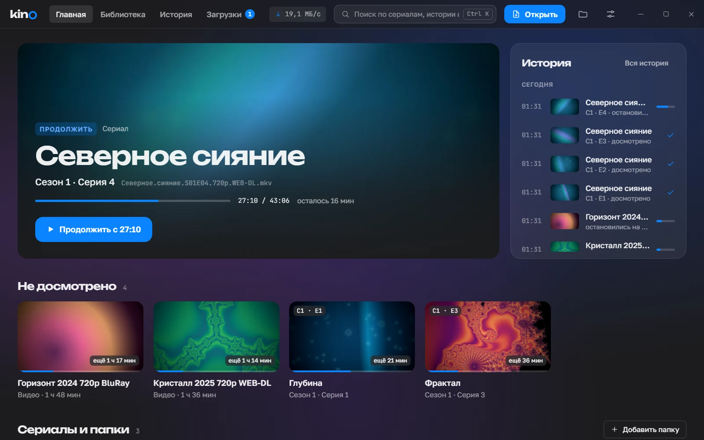
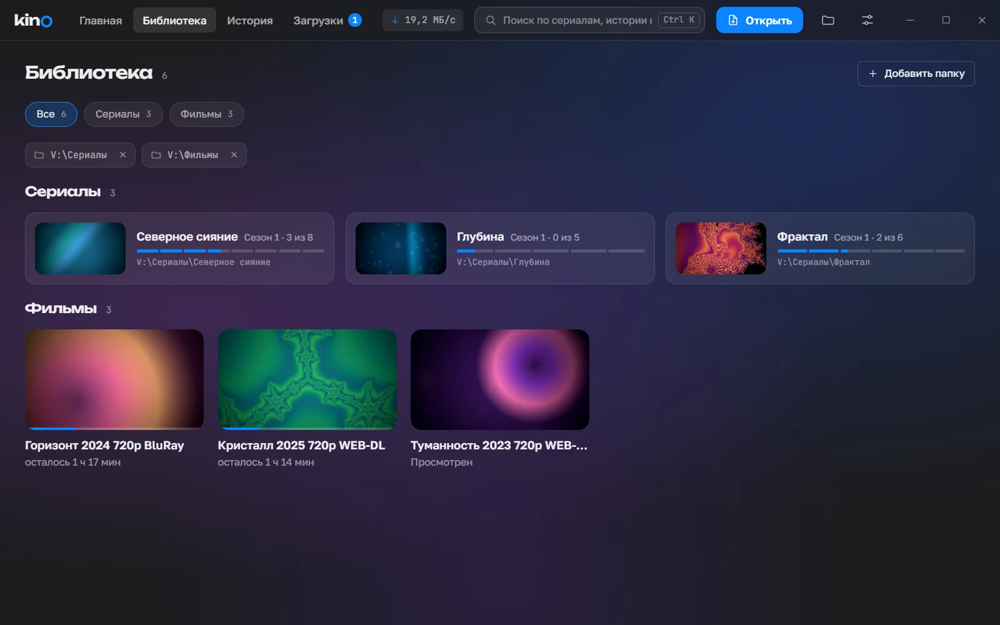
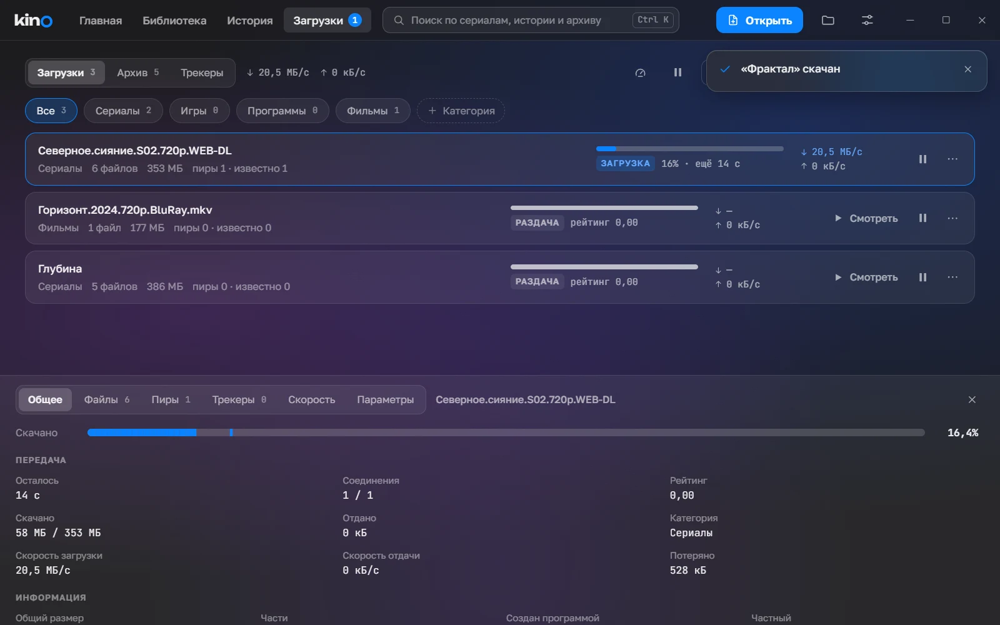
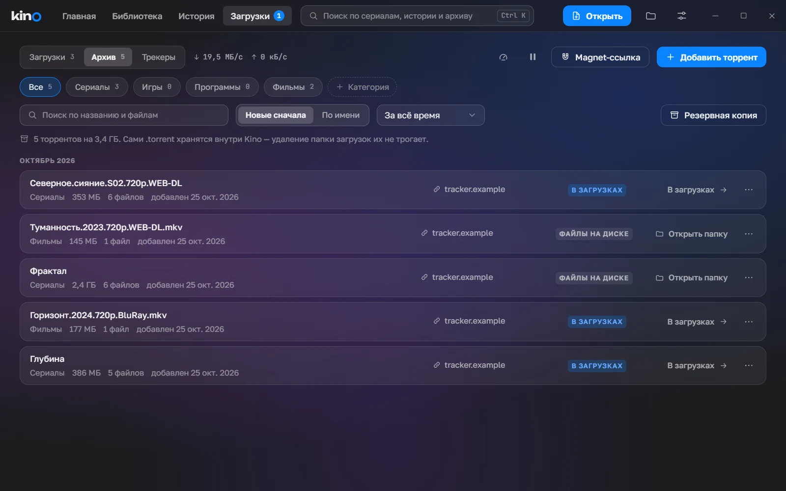
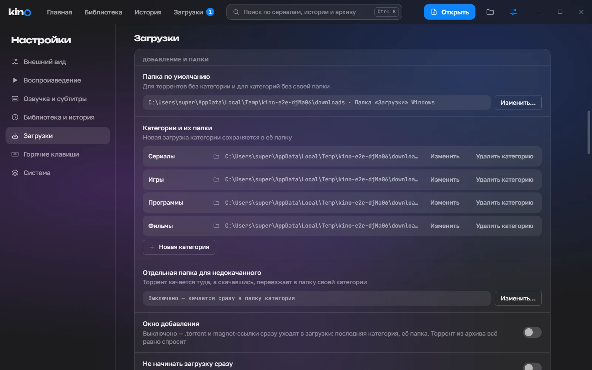

<p align="center">
  
</p>

<h1 align="center">Kino v2</h1>

<p align="center">
  <b>Видеоплеер и торрент-клиент для Windows в одном окне.</b><br>
  Смотрит что угодно, помнит, на какой секунде вы остановились, и навсегда хранит каждый скачанный торрент.
</p>

<p align="center">
  <a href="https://github.com/devatiywork/kino-v2/releases/latest"></a>
  
  
  
  <a href="LICENSE"></a>
</p>

<p align="center">
  <a href="https://github.com/devatiywork/kino-v2/releases/latest"><b>Скачать установщик</b></a> ·
  <a href="#возможности">Возможности</a> ·
  <a href="#установка">Установка</a> ·
  <a href="#сборка-из-исходников">Сборка</a>
</p>



Kino — две программы, которые знают друг о друге ровно столько, сколько нужно. **Плеер** на движке mpv открывает любые форматы, мгновенно переключает озвучку и субтитры, раскладывает сериалы по сезонам и сам включает следующую серию. **Торрент-клиент** качает сериалы, фильмы, игры и программы, а **архив** хранит каждый когда-либо добавленный торрент — через год его можно скачать снова в один клик, не разыскивая раздачу.

Интерфейс — на русском (есть английский), тёмная и светлая темы, стекло и размытие как в Windows 11.

## Возможности

### Плеер

- **Любые форматы**, которые понимает mpv: mkv, mp4, avi, ts, m2ts, mov, webm и другие; аппаратное декодирование.
- **Озвучка и субтитры переключаются мгновенно**, без перезагрузки видео. ASS/SSA со стилями, SRT, PGS. Внешние субтитры и озвучки рядом с видео (`Серия 5.ru.srt`, `Серия 5.English.mka`) подхватываются сами.
- **Продолжение с места остановки** — «Продолжено с 23:14 · Начать сначала».
- **Сериалы**: сезоны и серии по именам файлов (`S02E05`, `2x05`, «Серия 5»), автовоспроизведение следующей серии, N / P — соседние серии.
- **Память дорожек для сериала**: выбранные озвучка и субтитры включаются в следующих сериях. Подбор по языку и названию дорожки, а не по номеру. Если нужной дорожки нет, Kino скажет, какую выбрал вместо неё.
- Над видео — качество файла: «1080p · HEVC · HDR · 1,5 ГБ · 4,8 Мбит/с».
- Клик по видео — пауза, колесо — громкость (до 130 %), скорость от 0,5× до 2×, панель серий сезона сбоку.
- Медиаклавиши клавиатуры и плашка Windows с названием серии.

**Мини-плеер** — видео уходит в маленькое окно поверх остальных, а основное окно Kino остаётся свободным: можно смотреть, как качается следующий сезон, или листать библиотеку. Видео не перезапускается, а переезжает между окнами.

**Горячие клавиши** (переназначаются в настройках):

| Действие | Клавиша |
| --- | --- |
| Пауза / воспроизведение | Пробел |
| Назад / вперёд на 10 секунд | ← / → |
| Громче / тише | ↑ / ↓ |
| Во весь экран | F (выход — Escape) |
| Без звука | M |
| Субтитры вкл/выкл | S |
| Следующая / предыдущая серия | N / P |
| Поиск | Ctrl K |

### Главная, библиотека и история



- **Главная**: «Продолжить» с кадра, на котором остановились, недосмотренное с оставшимся временем, сериалы с прогрессом по сезону.
- **Библиотека**: сериалы и фильмы из папок медиатеки и из скачанного торрентами, по категориям; игры и программы из загрузок — рядом, с кнопкой «Открыть папку».
- **Страница сериала**: сезоны, серии с прогрессом, «Освободить место» для досмотренного сезона. Если файлы удалены, а торрент есть в архиве, — «Скачать снова»: серии встанут на место, история и запомненные дорожки сохранятся.
- **История** по дням: что, когда и на какой минуте.
- **Поиск** (Ctrl K) по истории, медиатеке и архиву торрентов.

### Торренты



- **Добавление** из `.torrent` (кнопка, перетаскивание в окно, двойной клик в Проводнике) и magnet-ссылок (кнопка, вставка из буфера, клик в браузере). Kino регистрируется обработчиком `.torrent` и `magnet:`.
- Окно добавления: категория (Сериалы, Игры, Программы, свои), папка, выбор файлов, страница раздачи для архива.
- **Подробности торрента** по образцу qBittorrent: общее с картой частей, файлы с приоритетами, пиры, трекеры, график скорости, параметры — лимиты, раздача до рейтинга, последовательная загрузка, суперсид, перенос файлов, проверка.
- **Очередь** загрузок и раздач, лимиты скорости, **альтернативные лимиты по расписанию**, правила остановки раздачи, режим «не раздавать после загрузки — сразу в архив».
- **Шифрование протокола (MSE/PE)**, как в qBittorrent, — пиры, которые его требуют, тоже подключаются. Проверено против libtorrent в обе стороны.
- **Постоянный порт** для входящих — его можно один раз пробросить на роутере; UPnP / NAT-PMP, DHT, PeX, LSD, прокси SOCKS5.
- Кнопка **«Смотреть»** у скачанного торрента с видео — файлы сразу в плеере, папка в медиатеке.
- В заголовке окна — число загрузок и общая скорость; при закрытии окна во время загрузок Kino уходит в **трей**, а когда торрент скачан, присылает уведомление Windows.

### Архив — каждый торрент навсегда



- Хранится всё, что когда-либо добавляли: сам `.torrent`, название, размер, список файлов, категория, папка, даты и страница раздачи — даже после удаления файлов.
- Три разных удаления: **убрать из загрузок** (файлы и запись остаются), **удалить с файлами** (запись остаётся с пометкой), **удалить из архива** — только с подтверждением.
- **Скачать снова** в один клик, **снова раздавать** то, что уже на диске. Тот же торрент второй раз не дублируется — Kino покажет «Уже в архиве».
- Поиск по названию и файлам, фильтр по категориям и датам, резервная копия всего архива в один файл.

### Трекеры прямо в Kino

- Вкладка **«Трекеры»** с закладками сайтов (Рутрекер, RuTor и любые свои): у каждого сайта своя вкладка, как в браузере, вход запоминается.
- Клик по `.torrent` или magnet-ссылке на сайте сразу открывает окно добавления, а **ссылка на страницу раздачи записывается в архив сама**.
- Встроенная блокировка рекламы (EasyList и RuAdList).
- Сайт работает изолированно: у страницы трекера нет доступа к Kino. Капчу сайт показывает вам, Kino её не обходит.

### Настройки



Тема (тёмная, светлая, как в системе), акцентный цвет, язык, воспроизведение, озвучка и субтитры по умолчанию, медиатека, загрузки по образцу параметров qBittorrent, горячие клавиши, системные — открывать видео через Kino, не засыпать во время просмотра и загрузок, проверка обновлений. Всё применяется сразу, без кнопки «Сохранить».

## Установка

1. Скачайте `Kino-v2_<версия>_x64-setup.exe` со страницы [последнего релиза](https://github.com/devatiywork/kino-v2/releases/latest).
2. Запустите. Kino ставится для всех пользователей в `C:\Program Files\Kino v2` и попросит права администратора.
3. Установщик не подписан, поэтому Windows SmartScreen может предупредить: «Подробнее» → «Выполнить в любом случае».

Нужны Windows 10 или 11 (x64) и WebView2 — в Windows 11 он уже есть. При первой раздаче брандмауэр спросит разрешение на входящие подключения. Новые версии Kino находит сам, если в настройках включена проверка обновлений.

## Приватность

Никакой телеметрии, аналитики и отчётов о сбоях. Kino ходит в сеть только по протоколу BitTorrent, к сайтам трекеров — пока открыта их вкладка, и на GitHub за новой версией — если это включено. Всё хранится на этом компьютере, в `%APPDATA%\local.kino.app`.

## Сборка из исходников

Нужны Windows 10/11, [Bun](https://bun.sh), [Rust](https://rustup.rs) (stable, MSVC), Visual Studio Build Tools (C++) и 7-Zip.

```bash
bun install
```

```bash
powershell -ExecutionPolicy Bypass -File scripts/fetch-libmpv.ps1
```

```bash
bun run dev
```

Установщик (NSIS) — в `apps/desktop/src-tauri/target/release/bundle/nsis`:

```bash
bun run --filter @kino/desktop build
```

Тесты — модульные и интеграционные (Vitest, `cargo test`) и E2E: Playwright управляет настоящим Kino через CDP, окна тестов при этом скрыты.

```bash
bun run test
```

```bash
bun run e2e
```

### Как устроено

| Часть | Чем сделано |
| --- | --- |
| Окно и ядро | [Tauri 2](https://tauri.app), Rust |
| Видео | [libmpv](https://mpv.io) в процессе Kino: mpv рисует в своё окно под прозрачной страницей WebView2, интерфейс — поверх видео |
| Торренты | [librqbit](https://github.com/ikatson/rqbit) 9 — своя копия с шифрованием протокола MSE/PE (`apps/desktop/src-tauri/crates/librqbit`) |
| Данные | SQLite: медиатека, история, архив торрентов |
| Интерфейс | React 19, TypeScript, Vite, Tailwind CSS 4, react-aria; Feature-Sliced Design |
| Компоненты | `packages/ui` — свой набор (`@kino/ui`) с токенами дизайна |
| Тесты | Vitest, Testing Library, Playwright |

```
apps/desktop/        приложение: src — интерфейс, src-tauri — ядро на Rust, e2e — тесты Playwright
packages/ui/         библиотека компонентов @kino/ui
design/              прототип интерфейса
scripts/             libmpv, списки блокировки рекламы, иконки
```

## Лицензия

Kino — под лицензией [MIT](LICENSE): можно свободно использовать, менять и распространять, сохраняя уведомление об авторских правах.

Сторонние компоненты — под своими лицензиями:

- [mpv / libmpv](https://mpv.io) — LGPL 2.1+ (сборка [shinchiro/mpv-winbuild-cmake](https://github.com/shinchiro/mpv-winbuild-cmake)).
- [librqbit](https://github.com/ikatson/rqbit) — Apache 2.0, © Igor Katson; копия с изменениями описана в `crates/librqbit/KINO.md`.
- [Tauri](https://tauri.app) — MIT / Apache 2.0.
- Списки блокировки рекламы [RuAdList + EasyList](https://forums.lanik.us/viewforum.php?f=102) — CC BY 3.0 / CC BY-SA 3.0 (`apps/desktop/src-tauri/filters`).

Видео на скриншотах — сгенерированные фракталы и градиенты (`apps/desktop/e2e/readme`), названия сериалов и фильмов выдуманы.
