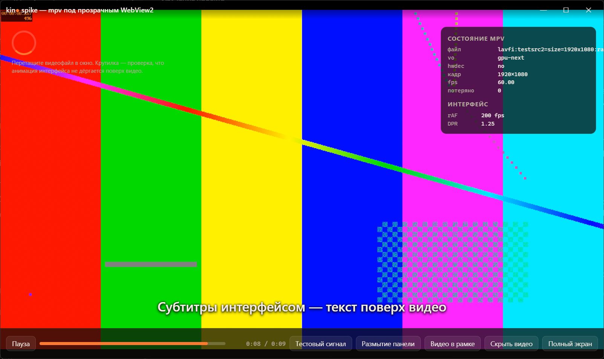

# Spike: libmpv под прозрачным WebView2 в Tauri

**Вопрос:** может ли Kino 2 показывать видео mpv внутри окна Tauri, а интерфейс (React) рисовать поверх видео — с полупрозрачными панелями, без отдельного окна для видео?

**Ответ: да.** Запасной вариант (внешний `mpv.exe` + JSON IPC) не нужен.



## Рецепт

1. Окно **непрозрачное**: `"transparent": false`.
2. Фон WebView2 **прозрачный**: `"backgroundColor": "#00000000"` (на Windows альфа 0 делает прозрачным только слой WebView, слой окна остаётся непрозрачным). `html, body { background: transparent }`.
3. Своё дочернее окно для видео (`KinoVideoHost`) внутри окна Tauri, внизу z-порядка (`HWND_BOTTOM`), стиль `WS_CHILD | WS_VISIBLE | WS_DISABLED | WS_CLIPCHILDREN` — **без `WS_CLIPSIBLINGS`**. `WM_NCHITTEST → HTTRANSPARENT`.
4. libmpv в процессе (`libmpv2`), `wid` = это окно, `vo=gpu-next`, `gpu-api=d3d11`, `hwdec=auto-safe`, ввод mpv выключен — весь ввод получает WebView2.
5. `WindowEvent::Resized` → `SetWindowPos` окна видео (физические пиксели).

## Что не работает

- **`"transparent": true`** — DWM берёт прозрачность из альфа-канала всего окна; окно видео рисует непрозрачные пиксели, но в итоге сквозь Kino виден рабочий стол, а видео нет.
- **`WS_CLIPSIBLINGS` у окна видео** — WebView2 (соседнее окно выше) целиком вырезает его область, прозрачен он или нет: на месте видео чёрный фон.

## Проверено

| Что | Результат |
| --- | --- |
| Интерфейс поверх видео | полупрозрачные панели, текст, анимация — смешиваются с видео |
| Настоящая серия (720p H.264, 5 озвучек, 2 субтитров) | `hwdec=d3d11va`, `gpu-next`, 0 потерянных кадров |
| Переключение озвучки (`aid`) | 2 мс, видео не перезагружается, время идёт дальше |
| Субтитры mpv (SRT) | рисуются в видео, под интерфейсом |
| Видео в части окна | встаёт точно в заданный прямоугольник ([снимок](video-rect.png)) |
| Скрыть / показать видео | `ShowWindow` окна видео |
| Полный экран, развернуть, свернуть и вернуть | видео сразу подстраивается |
| Клики, перетаскивание окна за заголовок | всё получает страница |
| Перетаскивание файла в окно | событие Tauri `DragDrop` с путями |
| Нагрузка (debug-сборка, 720p, опрос состояния 4 раза в секунду) | ≈17% одного ядра вместе с WebView2 (1,4% всего CPU), 179 МБ |

## Ограничения для дизайна

- `backdrop-filter: blur()` **не размывает видео** — он видит только веб-содержимое. Поверх видео — непрозрачные или полупрозрачные подложки, без «матового стекла».
- Субтитры mpv рисуются внутри видео: когда видна панель управления, их надо поднимать (`sub-margin-y` / `sub-pos`), иначе панель их перекрывает.

## Не проверено

- Анимации Windows 11 при сворачивании и привязка окон (Snap) — окно теперь непрозрачное, так что должны работать штатно, но глазами не проверено.
- HDR, HEVC 10 бит 4K, несколько мониторов с разным масштабом, долгий просмотр.
- Живое изменение размера мышью (нет ли чёрных полос на краях во время перетаскивания).
- Опрос состояния в spike — `setInterval`; в приложении будет `observe_property` и события Tauri.

## Как запустить

```powershell
powershell -ExecutionPolicy Bypass -File scripts/fetch-libmpv.ps1   # vendor/libmpv: dll, mpv.lib, заголовки
cargo run --manifest-path spikes/tauri-mpv/src-tauri/Cargo.toml -- "D:\путь\к\видео.mkv"
```

Без аргумента играет тестовый сигнал `av://lavfi:testsrc2`. Видео можно перетащить в окно.
